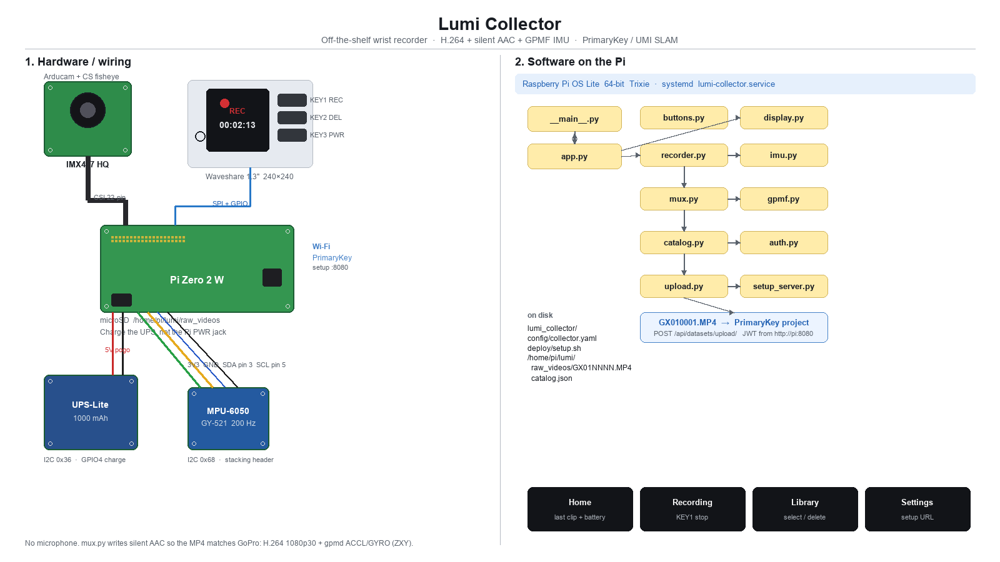

# Lumi collector (Pi Zero 2 W)

A GoPro Hero 10–shaped gripper recorder: one button starts an episode, the
file on the SD card is an MP4 with H.264, audio, and a `gpmd` IMU track so
`[universal_manipulation_interface](https://github.com/real-stanford/universal_manipulation_interface)`
`00_process_videos.py` → `01_extract_gopro_imu.py` can consume it unchanged.

## OS

**[Raspberry Pi OS Lite 64-bit (Trixie)](https://www.raspberrypi.com/software/operating-systems/)** — no desktop.

The Zero 2 W has 512 MB. A desktop image will page itself to death the moment
the H.264 encoder and Wi-Fi run together. Lite plus the official
`libcamera`/`picamera2` stack is the only combination that is both fast and
supported: the VideoCore hardware encoder does 1080p30, I2C/SPI are first-class,
and `systemd` restarts the appliance after a crash.

Do not use the original Pi Zero (single-core ARM11). Do not use Ubuntu,
DietPi, or the 32-bit Lite image — you would be re-fighting the camera stack.


|                        |                                                                                                                                                                                               |
| ---------------------- | --------------------------------------------------------------------------------------------------------------------------------------------------------------------------------------------- |
| Imager (recommended)   | [https://www.raspberrypi.com/software/](https://www.raspberrypi.com/software/)                                                                                                                |
| OS list                | [https://www.raspberrypi.com/software/operating-systems/](https://www.raspberrypi.com/software/operating-systems/)                                                                            |
| This Lite 64-bit image | [2026-09-15-raspios-trixie-arm64-lite.img.xz](https://downloads.raspberrypi.org/raspios_lite_arm64/images/raspios_lite_arm64-2026-09-15/2026-09-15-raspios-trixie-arm64-lite.img.xz) (516 MB) |
| Image folder           | [https://downloads.raspberrypi.org/raspios_lite_arm64/images/raspios_lite_arm64-2026-09-15/](https://downloads.raspberrypi.org/raspios_lite_arm64/images/raspios_lite_arm64-2026-09-15/)      |
| SHA256                 | `cdf4f3bfac35ae947b46e4e767f935453810549779ac3290e05a6754aee627e5`                                                                                                                            |


Compatible with Pi Zero 2 W. Use a **16 GB or larger** microSD (Class 10 / A1).
A newer `raspios_lite_arm64-*` folder at
[https://downloads.raspberrypi.org/raspios_lite_arm64/images/](https://downloads.raspberrypi.org/raspios_lite_arm64/images/) is fine — pick
the latest `*-raspios-trixie-arm64-lite.img.xz`, not Desktop or Full.

### Flash the card (Raspberry Pi Imager)

1. Install [Raspberry Pi Imager](https://www.raspberrypi.com/software/) on
  the Mac or PC that has the card reader.
2. Insert the microSD card.
3. In Imager:
  - **Raspberry Pi Device** → `Raspberry Pi Zero 2 W`
  - **Operating System** → `Raspberry Pi OS (other)` →
  `Raspberry Pi OS Lite (64-bit)`
  - **Storage** → the microSD card
4. Click **Next**, then **Edit Settings** (do this *before* writing):
  - **General**: hostname `lumi-collector`, username `pi`, set a password
  - **General**: your 2.4 GHz Wi-Fi SSID and password (Zero 2 W has no 5 GHz)
  - **Services**: enable SSH (password or a public key)
  - **Options**: leave eject-on-finish on
5. Save, confirm you want to apply OS customisation, then **Yes** to erase
  the card. Wait until Imager says you can remove it.

If you downloaded the `.img.xz` yourself instead of using the Imager catalog:
**Operating System** → `Use custom` → select
`2026-09-15-raspios-trixie-arm64-lite.img.xz`, then the same Settings step.
Imager decompresses the xz; you do not unpack it first.

### First boot, then this repo

Seat the card in the Zero 2 W, power the UPS-Lite, wait ~60 s, then from a
computer on the same Wi-Fi:

```bash
ssh pi@lumi-collector.local
# or: ssh pi@<the-ip-the-router-gave-it>

sudo apt update && sudo apt upgrade -y
sudo apt install git -y

git clone git@github.com:solarian-dev/solarian-lumi-collector.git ~/solarian-lumi-collector
cd ~/solarian-lumi-collector
sudo bash deploy/setup.sh
sudo reboot
```

`setup.sh` enables I2C, SPI, and the IMX477 overlay, installs the venv with
`--system-site-packages` (so `picamera2` works), enables
`lumi-collector.service`, and shares `/home/pi` over Samba. It asks for a
password for that share, separate from the SSH login. See
[Download files locally](#download-files-locally). After reboot, open
`http://lumi-collector.local:8080` on a phone and sign into PrimaryKey.

```bash
# headless check without the HAT / camera
~/lumi/venv/bin/lumi-collector --mock --config ~/lumi/collector.yaml
```


## Hardware


| Role           | Part                                     | Notes                                            |
| -------------- | ---------------------------------------- | ------------------------------------------------ |
| Compute        | Raspberry Pi Zero 2 W **with header**    | CSI-2, 802.11n, hardware H.264                   |
| Camera         | Arducam IMX477 HQ + CS fisheye           | Same sensor you already run on the robot         |
| Display / keys | [Waveshare 1.44" LCD HAT](https://www.waveshare.com/wiki/1.44inch_LCD_HAT) (ST7735S, 128×128) | 3 buttons + joystick |
| IMU            | [HiLetgo GY-521 MPU-6050](https://a.co/d/07B4Yt1c) @ 200 Hz | 6-axis, I2C `0x68`. Noisier than a Hero BMI260 |
| Power          | UPS-Lite 1000 mAh (pogo, underside)      | Charge on the UPS micro-USB, not the Pi PWR jack |


Stack, bottom to top: **UPS-Lite → Zero 2 W → LCD HAT**. The camera hangs off
the **22-pin** CSI flex (Pi Zero is not the 15-pin Pi 4 cable). Tap I2C for the
IMU from a 40-pin **stacking header** — the LCD HAT covers the GPIO otherwise.

```
GY-521  VCC → header 3V3 (pin 1)
GY-521  GND → header GND (pin 9)
GY-521  SDA → GPIO2      (pin 3)
GY-521  SCL → GPIO3      (pin 5)
```

Leave `AD0`, `XDA`, `XCL`, and `INT` open. `AD0` has an internal pulldown, so the
address is already `0x68`. Power `VCC` from the Pi's 3V3 pin, not 5V.
The UPS fuel gauge on this I2C bus is an INA219 at `0x43`. Charge on the
screen is the cell voltage mapped from 3.0 V (empty) to 4.2 V (full). The
MPU-6050 at `0x68` does not clash with it.



Regenerate the poster with `python docs/render_architecture.py`.

### Buttons


| Control          | GPIO         | Function                                        |
| ---------------- | ------------ | ----------------------------------------------- |
| KEY1             | 21           | Start / stop recording                          |
| KEY2             | 20           | Delete last (home) or delete selected (library) |
| KEY3 short       | 16           | Settings / back                                 |
| KEY3 hold 2 s    | 16           | `shutdown -h now`                               |
| UPS slide switch | —            | Hard power                                      |
| Joystick         | 6/19/5/26/13 | Library, select, play                           |


Sign-in is not typed on the joystick. After boot, open
`http://<pi-ip>:8080` on a phone and log into PrimaryKey. The JWT stays on the
SD card.

## What "same as a Hero 10" means

UMI does not decode "a GoPro file" as a brand. It needs:

1. `raw_videos/*.MP4` named `GX01NNNN.MP4`
2. H.264 video + an audio track
3. A `gpmd` timed-metadata track (`handler_name=GoPro MET`) with ACCL @ m/s²
  and GYRO @ rad/s, stored ZXY, ~200 Hz
4. `creation_time` + `timecode` on the video stream (PyAV)
5. `QuickTime:CameraSerialNumber` (exiftool), used by `00_process_videos.py`

This appliance writes exactly that. A `.imu.json` sidecar is also kept next to
each file so a botched mux is still recoverable.

Honest limits versus a real Hero 10 Black:

- VideoCore encode is **1080p30**, not 1080p60 / 2.7K. SLAM still runs; you
lose temporal resolution.
- There is **no microphone**. The AAC track is silence so the container shape
matches. Add an I2S MEMS mic later if you care about audio.
- 1000 mAh is about **30–45 minutes** of 1080p + Wi-Fi. Fine for a session,
not a day. Step up the cell before you step up the board.
- The IMU is a GY-521 MPU-6050, not the Hero's BMI260. The `gpmd` track has
the same units and rate; the samples are noisier.


## Cloud

Selected episodes are zipped as `raw_videos/*.MP4` + `session.json` and POSTed
to `POST /api/datasets/upload/` on the signed-in PrimaryKey project. Today that
API only names `lerobot` and `zarr`; the collector sends `format=zarr` so the
bytes are stored as an opaque zip on the project. The UMI SLAM pipeline still
wants the MP4s on disk (`rsync` / download), not the PrimaryKey dataset viewer.

## Layout on the SD card

```
/home/pi/lumi/
  collector.yaml
  credentials.json
  catalog.json
  raw_videos/GX010001.MP4
  raw_videos/GX010001.imu.json
```

Copy `raw_videos/` onto a workstation session directory and run the UMI
scripts as usual. The share below is the whole `/home/pi` folder, so the
episodes are in `lumi/raw_videos`.

## Download files locally

`setup.sh` installs Samba, enables it, and asks you to set a password. Any
computer on the same Wi-Fi can open the Pi's home folder with that password.
The account is `pi`. The password is the one you typed at the Samba prompt,
not the SSH login. The hostname below is the one set in Imager
(`lumi-collector`); use whatever hostname the Pi actually has.

The share name is `pi`.

### Mac

In Finder, choose Go → Connect to Server (⌘K) and enter:

```text
smb://lumi-collector.local/pi
```

Sign in as `pi`.

### Windows

In File Explorer's address bar, enter:

```text
\\lumi-collector.local\pi
```

Sign in as `pi`. If Windows asks for a domain, use `pi` as the user and leave
the domain blank, or type `lumi-collector\pi`.

### Ubuntu

In Files, open Other Locations. At the bottom, in Connect to Server, enter:

```text
smb://lumi-collector.local/pi
```

Sign in as a registered user, name `pi`.
