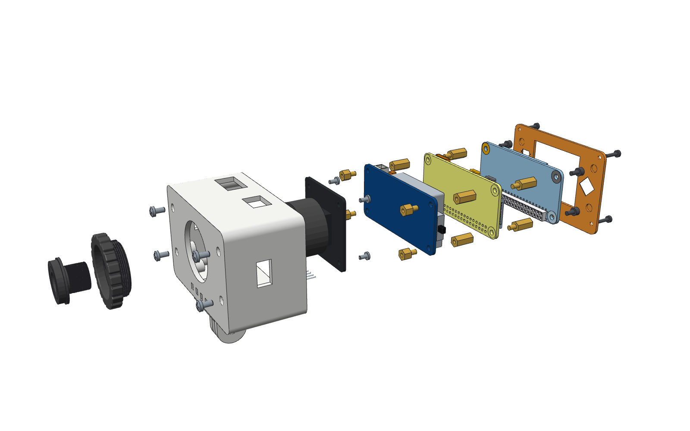
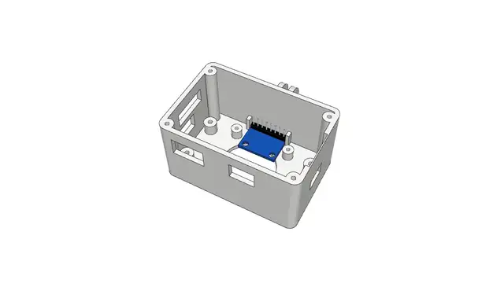
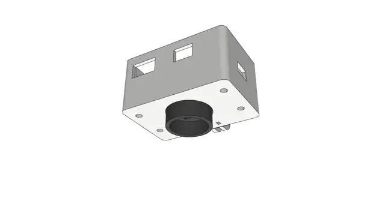
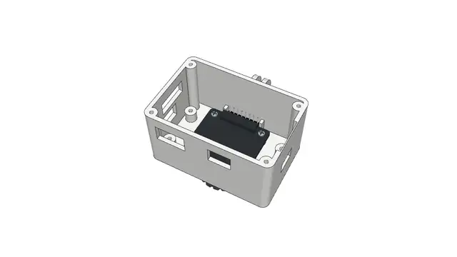
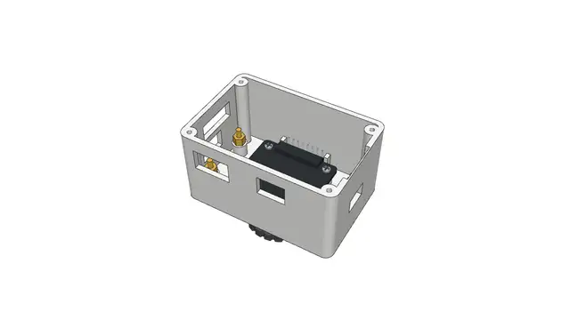
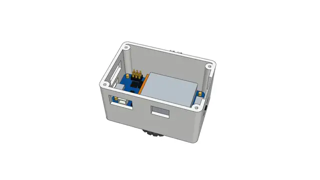
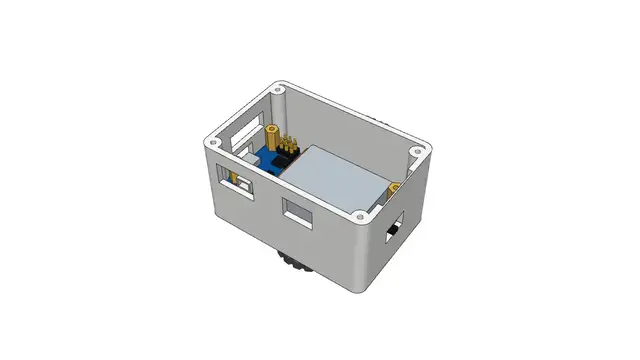
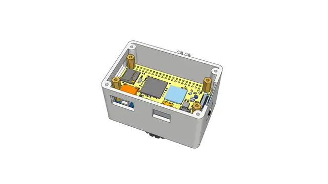
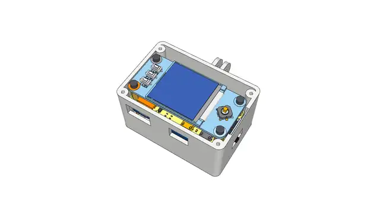
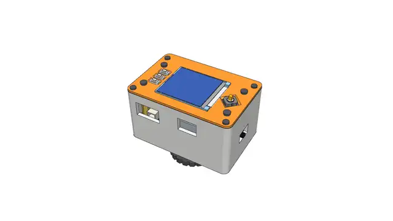

# Assembling the LUMI collector

This guide builds the handheld LUMI collector: a 3D-printed two-part enclosure
(front body and rear lid) around a Raspberry Pi Zero 2 W, the Raspberry Pi HQ
Camera with a 180° M12 fisheye, a Waveshare UPS HAT (C) and the Waveshare
1.44" LCD HAT. Get the parts first
([Sourcing parts](../README.md#sourcing-parts)) and print the enclosure
([Printing the enclosure](../README.md#printing-the-enclosure)).

Every step has a short animation rendered from the Onshape assembly. The
full build is also available as one video:
[`media/assembly/assembly_full.mp4`](media/assembly/assembly_full.mp4).
Each step's clip is in [`media/assembly/`](media/assembly/) as `.mp4`.

> **Fasteners.** The CAD models the standoffs and the screws for the camera
> and the front of the standoff stack. The LCD HAT and lid screws are not in
> the CAD; the animations draw them in to show where they go.

**Tools:** a small Phillips screwdriver (#0), a 5 mm nut driver or small
pliers for the hex standoffs, a soldering iron for the IMU wires, and a 5 mm
drill bit (see step 4).

**Before you start:** flash the microSD card ([Flash the card](../README.md#flash-the-card-raspberry-pi-imager))
and put it in the Pi, and leave the UPS HAT's slide switch **off** until the
lid is on.

---

## Step 1 — Lay the IMU in its pocket

| Parts | Fasteners |
| --- | --- |
| front body (printed), HiLetgo GY-521 with its header soldered, 4 thin wires (≈ 10 cm) | — |

Solder four wires to the GY-521's `VCC`, `GND`, `SCL` and `SDA` pins on the
side the header plastic is on. Leave `AD0`, `XDA`, `XCL` and `INT` open.
Lay the board flat against the inside of the front wall, in the pocket next to
the mount, with the header row towards the mount and the wires pointing up
out of the body. It has to go in first: the camera board covers it.

## Step 2 — Screw the HQ camera into the front body

| Parts | Fasteners |
| --- | --- |
| Raspberry Pi HQ Camera, Pi Zero camera cable (22-pin → 15-pin) | 4× M2×4 pan head |

1. Take the C-CS adapter ring and the tripod mount off the camera if they are
   fitted, and keep the dust cap on the sensor until step 3.
2. Plug the 15-pin end of the camera cable into the camera now; it's hard to
   reach once the board is in.
3. Lower the camera into the body with the lens barrel through the round
   opening in the front wall, over the IMU, and screw it to the four bosses
   with M2×4 screws. They thread into the plastic, so stop once the board is
   held.

## Step 3 — Screw on the M12 adapter and the fisheye lens

| Parts | Fasteners |
| --- | --- |
| CS-to-M12 adapter and 180° M12 fisheye (Arducam LN031 ships with both) | — |

From the front, screw the CS-to-M12 adapter into the camera's CS mount, then
screw the M12 lens into the adapter. Leave the lens a turn loose: you set the
focus in [Check the picture](../README.md#check-the-picture) once the collector
runs, then lock the camera's back-focus ring.

## Step 4 — Fix the short standoffs from the front

| Parts | Fasteners |
| --- | --- |
| 4× M2.5 male-female hex standoff, 4 mm + 4 mm stud | 4× M2.5×5 pan head |

Stand a 4 mm standoff, stud up, on each of the four bosses near the corners
of the body. Turn the body over and screw an M2.5×5 into each one through the
four holes in the front face.

> **Counterbores.** In the current CAD the four front counterbores are
> 4.2 mm across, but an M2.5 pan head is 5 mm. Open them up with a 5 mm drill
> by hand before this step (or widen them in Onshape before printing).

## Step 5 — Put the UPS HAT (C) on the studs

| Parts | Fasteners |
| --- | --- |
| Waveshare UPS HAT (C) with its 1000 mAh LiPo | — |

Stick the battery on the HAT's pad and plug its lead into the JST socket if
that isn't done yet. Lower the HAT onto the four studs with the pogo pins and
the battery facing up; the slide switch and the micro-USB charge port line up
with the openings in the side walls.

## Step 6 — Clamp it with the 10 mm standoffs

| Parts | Fasteners |
| --- | --- |
| 4× M2.5 female-female hex standoff, 10 mm | — |

Screw a 10 mm standoff onto each stud and snug it with the nut driver. These
clamp the UPS HAT and set the gap the pogo pins need to reach the Pi.

## Step 7 — Lay the Pi Zero 2 W on top

| Parts | Fasteners |
| --- | --- |
| Raspberry Pi Zero 2 W **with header**, microSD card | 4× M2.5 male-female hex standoff, 10 mm + 4 mm stud |

1. Solder the four IMU wires to the underside of the Pi's header pins:
   `VCC` → pin 1 (3V3), `SDA` → pin 3, `SCL` → pin 5, `GND` → pin 9 (see
   [Hardware](../README.md#hardware)). The LCD HAT covers the top of the header.
2. Plug the 22-pin end of the camera cable into the Pi's camera connector.
3. Lay the Pi on the 10 mm standoffs with the header along the mount side,
   so the UPS HAT's pogo pins land on the pads under the Pi. Fix it with four
   10 + 4 mm standoffs: their studs go through the Pi's holes into the
   standoffs below.

## Step 8 — Plug in the LCD HAT and screw it down

| Parts | Fasteners |
| --- | --- |
| Waveshare 1.44" LCD HAT | 4× M2.5×5 |

Press the HAT straight down onto the Pi's header, screen up, until it sits on
the four standoffs. Screw it down with four M2.5×5 screws. Their heads sit in
the four round openings of the lid.

## Step 9 — Close the rear lid

| Parts | Fasteners |
| --- | --- |
| rear lid (printed) | 4× M2×8 pan head self-tapping |

Lay the lid on with the three button openings over KEY1–KEY3 and the diamond
over the joystick. Check that every button clicks, then screw the lid to the
four corner posts with M2×8 self-tapping screws. Stop when the lid is held;
the posts are plastic.

## Done

Charge it on the UPS HAT's micro-USB port (not the Pi's), then slide the switch
on. Next, follow the software steps in the [README](../README.md#first-boot-then-this-repo):
run `deploy/setup.sh`, set the focus with `solarian lumi --stream`, and mount
the collector on the gripper with the fingers on its side.

---

### Regenerating these animations

The animations, stills and print-oriented STLs are generated from the Onshape
assembly by [`tools/assembly_render`](../tools/assembly_render/README.md).
